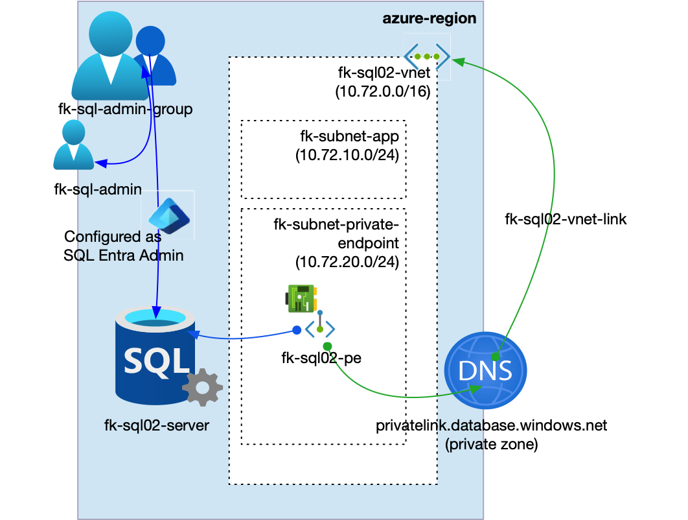
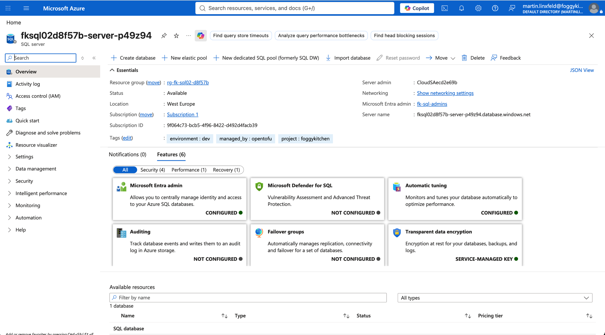
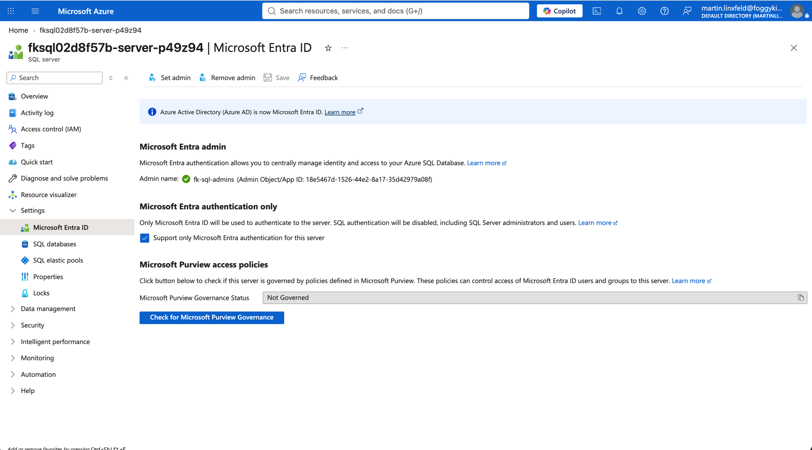
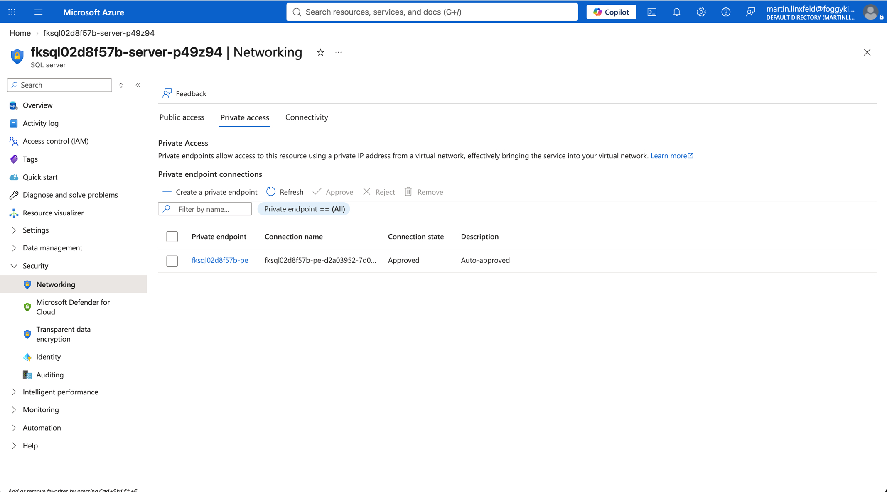
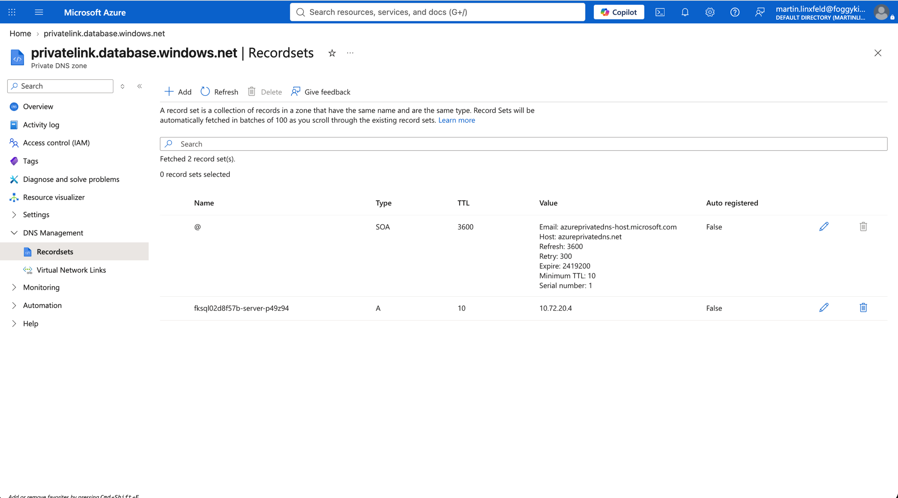
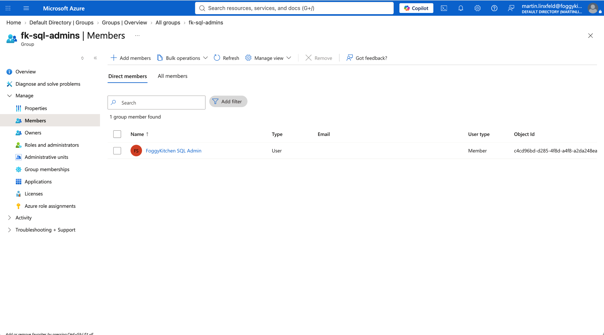

# Example 02: Azure SQL with Microsoft Entra Administrator

In this Azure SQL example, we deploy an **Azure SQL logical server** and one **Azure SQL Database** using **Terraform/OpenTofu**, then configure a **Microsoft Entra security group** as the SQL server administrator.
The SQL server is deployed with SQL authentication disabled, so administrator access is handled through Microsoft Entra only.

This example builds on the **Private Endpoint deployment path** from Example 01 and adds the Entra administrator configuration exposed by the local SQL module.

---

## Architecture Overview



This deployment creates:

- A dedicated **Azure Resource Group**
- One **Azure VNet** using `terraform-az-fk-vnet`
- One application subnet for future client workloads
- One subnet prepared for Private Endpoints
- One **Private DNS Zone** using `terraform-az-fk-private-dns`
- One **Microsoft Entra user** using `terraform-az-fk-entra-user`
- One **Microsoft Entra security group** using `terraform-az-fk-entra-group`
- One **Azure SQL logical server** using the local `terraform-az-fk-sql` module
- One **Azure SQL Database** named `foggydb`
- One **Private Endpoint** using `terraform-az-fk-private-endpoint`
- One Private DNS Zone Group attached to the Private Endpoint

The SQL module is called without `administrator_login` or `administrator_password`.
The module validation allows that only when `azuread_administrator.azuread_authentication_only` is `true`.

---

## Network Layout

- **VNet CIDR:** `10.72.0.0/16`
- **Application subnet:** `10.72.10.0/24`
- **Private Endpoint subnet:** `10.72.20.0/24`
- **Private Link subresource:** `sqlServer`
- **Private DNS Zone:** `privatelink.database.windows.net`

The Azure SQL logical server remains an Azure PaaS resource.
Only the Private Endpoint network interface is placed inside the `fk-subnet-private-endpoint` subnet.

---

## Deployment Steps

Copy the example variables file and set values for the Entra administrator user principal name and initial password:

```bash
cp terraform.tfvars.example terraform.tfvars
```

Initialize and apply the Terraform/OpenTofu configuration:

```bash
tofu init
tofu plan
tofu apply
```

After a successful deployment, OpenTofu will output:

- The Azure SQL logical server ID
- The Azure SQL logical server FQDN
- The Microsoft Entra administrator login
- The Entra-only authentication status
- The Private Endpoint ID
- The created Azure SQL database IDs

---

## Runtime Notes

After deployment, the Azure SQL server should:

- have public network access disabled
- be associated with a Private Endpoint
- resolve through `privatelink.database.windows.net`
- expose the `foggydb` database
- have a Microsoft Entra security group configured as server administrator
- have SQL authentication disabled

Connect with a Microsoft Entra identity that is a member of the configured administrator group.
The Entra user created by this example has `force_password_change = true`, so complete the first sign-in password change before using it for database administration.

---

## Azure Console And Runtime Verification

### Azure SQL Logical Server

In the Azure portal, verify that the Azure SQL logical server exists in the expected resource group and region, and that the `foggydb` database is online.



### Microsoft Entra Administrator

Confirm that the Microsoft Entra security group is configured as the SQL server administrator and that Microsoft Entra-only authentication is enabled.



### Private Endpoint Connection

Confirm that the Private Endpoint connection is approved and attached to the Azure SQL logical server.



### Private DNS Zone Record Set

Confirm that the Private DNS Zone contains an `A` record for the SQL server that points to the Private Endpoint IP address.



### Microsoft Entra Group Membership

Confirm that the administrator user is a member of the configured Microsoft Entra security group.



---

## Cleanup

To remove all resources created by this example:

```bash
tofu destroy
```

---

## Summary

This example demonstrates:

- How to deploy an **Azure SQL logical server** and **Azure SQL Database** using Terraform/OpenTofu
- How to compose the SQL module with Microsoft Entra administrator inputs
- How to disable SQL authentication by using Entra-only authentication
- How to use a Microsoft Entra security group as the SQL server administrator
- How to keep Private Endpoint concerns outside the root SQL module

---

## Learn More

Visit [FoggyKitchen.com](https://foggykitchen.com/) for Azure, OCI, multicloud, and Terraform/OpenTofu learning resources.

---

## License

Licensed under the **Universal Permissive License (UPL), Version 1.0**.
See [LICENSE](../../LICENSE) for more details.

---

© 2026 [FoggyKitchen.com](https://foggykitchen.com) - Cloud. Code. Clarity.
