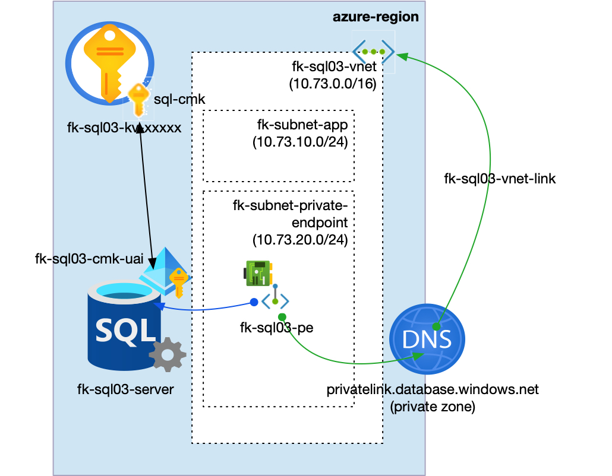
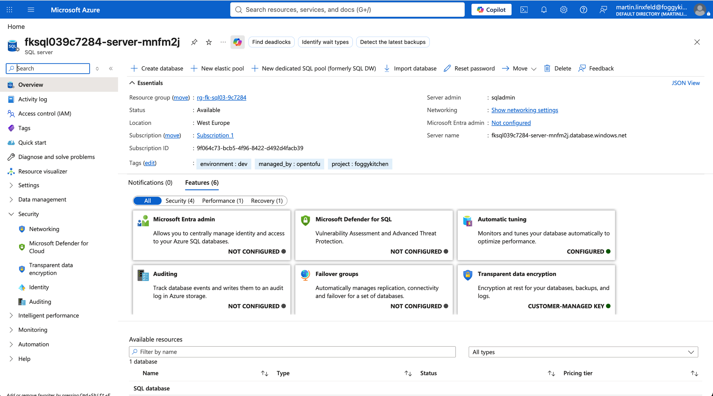
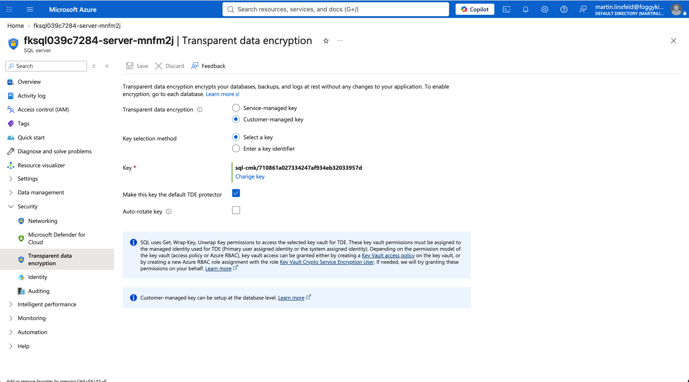
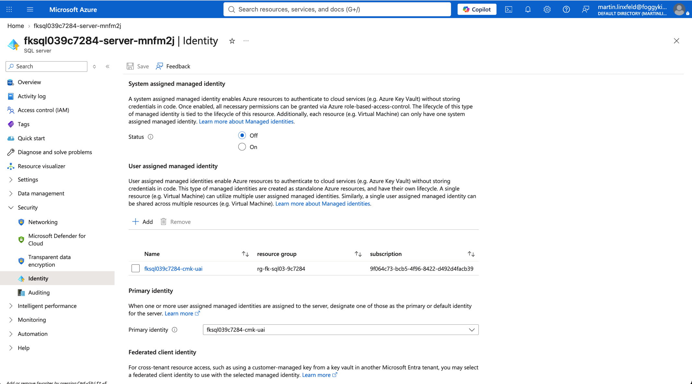
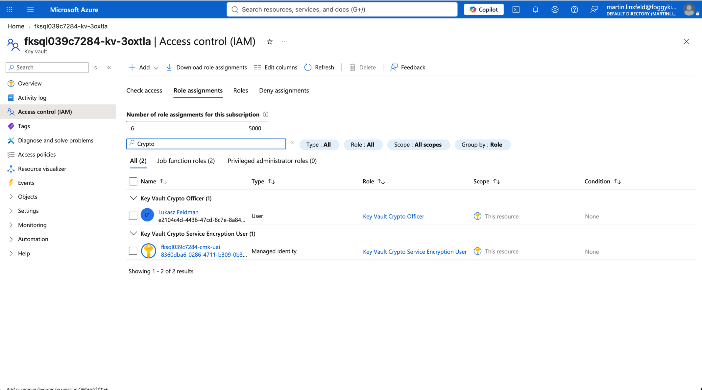

# Example 03: Azure SQL with Customer-Managed Key

In this Azure SQL example, we deploy an **Azure SQL logical server** and one **Azure SQL Database** using **Terraform/OpenTofu**, then configure server-level transparent data encryption with a **customer-managed Key Vault key**.
The SQL server uses a user-assigned managed identity to access the encryption key.

This example builds on the **Private Endpoint deployment path** from Example 01 and adds the identity, Key Vault, RBAC, and customer-managed key configuration required by Azure SQL TDE.

---

## Architecture Overview



This deployment creates:

- A dedicated **Azure Resource Group**
- One **Azure VNet** using `terraform-az-fk-vnet`
- One application subnet for future client workloads
- One subnet prepared for Private Endpoints
- One **Private DNS Zone** using `terraform-az-fk-private-dns`
- One **user-assigned managed identity** using `terraform-az-fk-managed-identity`
- One **Key Vault** using `terraform-az-fk-key-vault`
- One **RSA 3072 Key Vault key** using `terraform-az-fk-key-vault-key`
- One RBAC assignment for `Key Vault Crypto Service Encryption User`
- One **Azure SQL logical server** using the local `terraform-az-fk-sql` module
- One **Azure SQL Database** named `foggydb`
- One **Private Endpoint** using `terraform-az-fk-private-endpoint`
- One Private DNS Zone Group attached to the Private Endpoint

The SQL server receives `identity`, `primary_user_assigned_identity_id`, and a versioned `transparent_data_encryption_key_vault_key_id` directly.
The SQL module does not create Key Vault, managed identity, or RBAC resources.

---

## Network Layout

- **VNet CIDR:** `10.73.0.0/16`
- **Application subnet:** `10.73.10.0/24`
- **Private Endpoint subnet:** `10.73.20.0/24`
- **Private Link subresource:** `sqlServer`
- **Private DNS Zone:** `privatelink.database.windows.net`

The Azure SQL logical server remains an Azure PaaS resource.
Only the Private Endpoint network interface is placed inside the `fk-subnet-private-endpoint` subnet.

---

## Deployment Steps

Copy the example variables file and set a strong SQL administrator password:

```bash
cp terraform.tfvars.example terraform.tfvars
```

Initialize and apply the Terraform/OpenTofu configuration:

```bash
tofu init
tofu plan
tofu apply
```

After a successful deployment, OpenTofu will output:

- The Azure SQL logical server ID
- The Azure SQL logical server FQDN
- The customer-managed key status
- The managed identity principal ID
- The Key Vault key ID used for TDE
- The Private Endpoint ID
- The created Azure SQL database IDs

---

## Runtime Notes

After deployment, the Azure SQL server should:

- have public network access disabled
- be associated with a Private Endpoint
- resolve through `privatelink.database.windows.net`
- expose the `foggydb` database
- have a user-assigned managed identity attached
- use a customer-managed key as the transparent data encryption protector

Azure SQL validates access to the Key Vault key when the server-level TDE key is configured.
This example wires `depends_on` so the key and RBAC assignment are created before the SQL server.

The Key Vault uses purge protection and a 90-day soft delete retention period.
Destroying the example removes Terraform-managed resources, but the soft-deleted Key Vault name may remain reserved until it is purged or the retention period expires.

---

## Azure Console And Runtime Verification

### Azure SQL Logical Server

In the Azure portal, verify that the Azure SQL logical server exists in the expected resource group and region, and that customer-managed key encryption is shown on the server overview.



### Transparent Data Encryption

Confirm that Transparent data encryption uses a customer-managed key and that the configured Key Vault key is selected as the default protector.



### Managed Identity

Confirm that the user-assigned managed identity is attached to the SQL server and selected as the primary identity.



### Key Vault RBAC

Confirm that the managed identity has `Key Vault Crypto Service Encryption User` on the Key Vault.



---

## Cleanup

To remove all resources created by this example:

```bash
tofu destroy
```

---

## Summary

This example demonstrates:

- How to deploy an **Azure SQL logical server** and **Azure SQL Database** using Terraform/OpenTofu
- How to compose the SQL module with a user-assigned managed identity
- How to configure Azure SQL transparent data encryption with a customer-managed Key Vault key
- How to grant the SQL managed identity access to the customer-managed key through Azure RBAC
- How to keep Key Vault, identity, RBAC, and Private Endpoint concerns outside the root SQL module

---

## Learn More

Visit [FoggyKitchen.com](https://foggykitchen.com/) for Azure, OCI, multicloud, and Terraform/OpenTofu learning resources.

---

## License

Licensed under the **Universal Permissive License (UPL), Version 1.0**.
See [LICENSE](../../LICENSE) for more details.

---

© 2026 [FoggyKitchen.com](https://foggykitchen.com) - Cloud. Code. Clarity.
