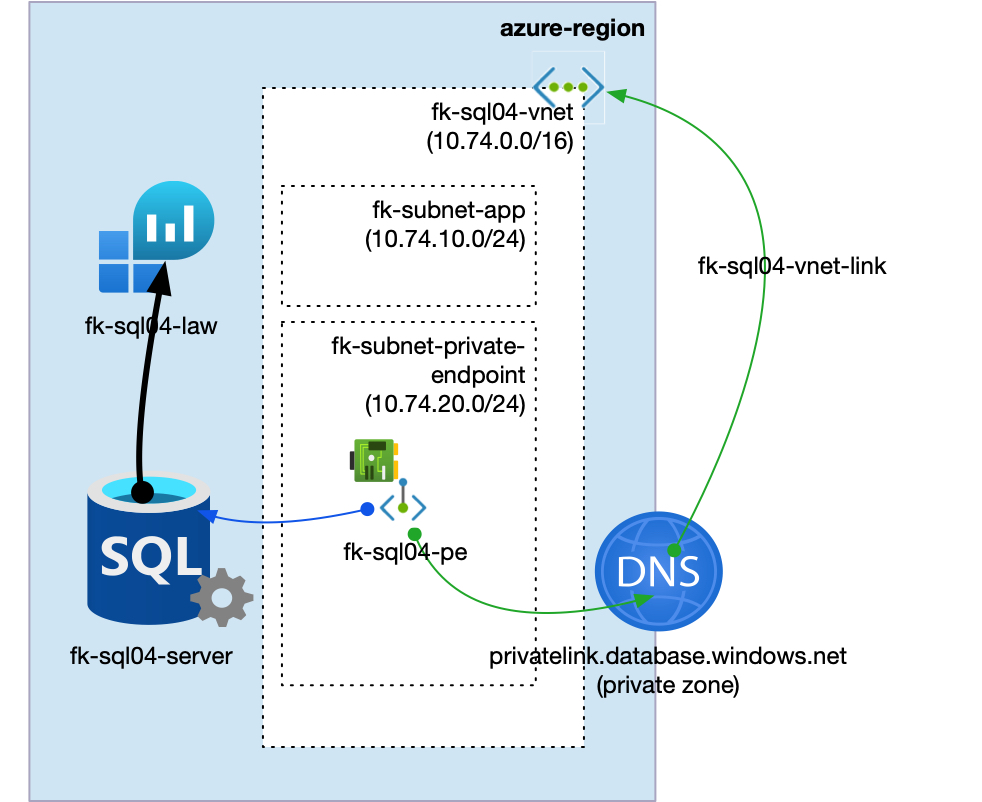
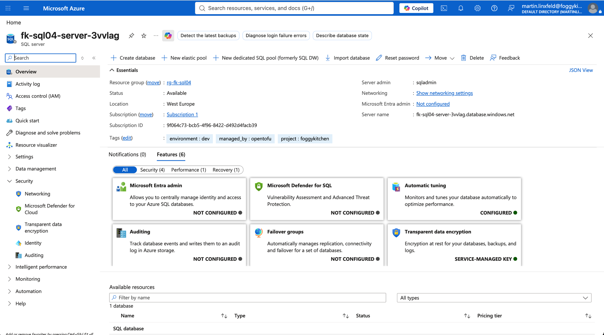
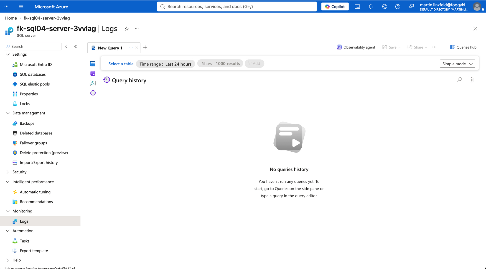
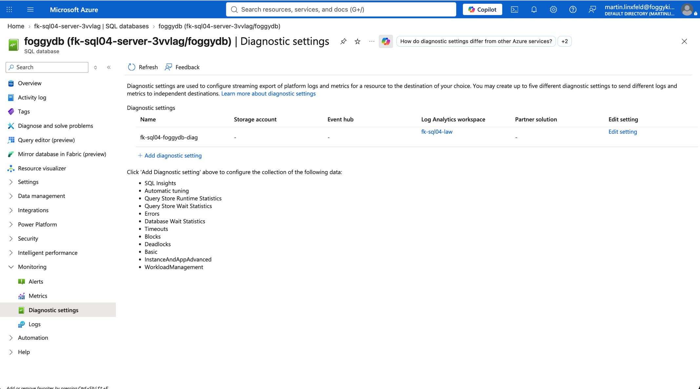
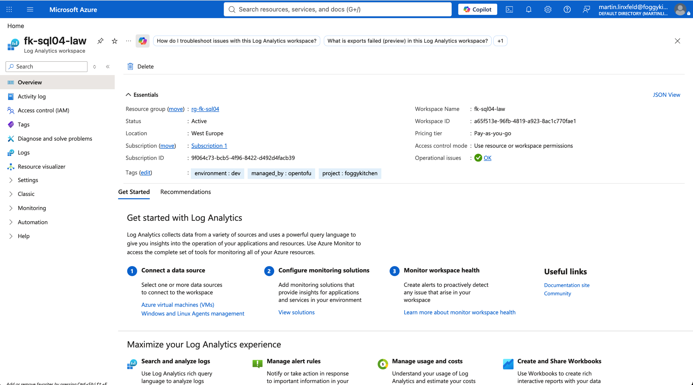

# Example 04: Azure SQL Diagnostics

In this Azure SQL example, we deploy an **Azure SQL logical server** and one **Azure SQL Database** using **Terraform/OpenTofu**, then configure **Azure Monitor diagnostic settings** for both SQL resource levels.
Server-level diagnostics are attached to the logical server, and database-level diagnostics are attached to the selected Azure SQL Database.

This example builds on the **Private Endpoint deployment path** from Example 01 and adds Log Analytics integration through the diagnostic settings inputs exposed by the local SQL module.

---

## Architecture Overview



This deployment creates:

- A dedicated **Azure Resource Group**
- One **Azure VNet** using `terraform-az-fk-vnet`
- One application subnet for future client workloads
- One subnet prepared for Private Endpoints
- One **Private DNS Zone** using `terraform-az-fk-private-dns`
- One **Log Analytics Workspace** using `terraform-az-fk-log-analytics`
- One **Azure SQL logical server** using the local `terraform-az-fk-sql` module
- One **Azure SQL Database** named `foggydb`
- One server-level Azure Monitor diagnostic setting
- One database-level Azure Monitor diagnostic setting
- One **Private Endpoint** using `terraform-az-fk-private-endpoint`
- One Private DNS Zone Group attached to the Private Endpoint

Azure SQL diagnostics are configured at two resource levels.
The logical server emits server-level logs and metrics, while each selected database can emit database-specific logs and database metric categories.

---

## Network Layout

- **VNet CIDR:** `10.74.0.0/16`
- **Application subnet:** `10.74.10.0/24`
- **Private Endpoint subnet:** `10.74.20.0/24`
- **Private Link subresource:** `sqlServer`
- **Private DNS Zone:** `privatelink.database.windows.net`

The Azure SQL logical server remains an Azure PaaS resource.
Only the Private Endpoint network interface is placed inside the `fk-subnet-private-endpoint` subnet.

---

## Deployment Steps

Copy the example variables file and set a strong SQL administrator password:

```bash
cp terraform.tfvars.example terraform.tfvars
```

Initialize and apply the Terraform/OpenTofu configuration:

```bash
tofu init
tofu plan
tofu apply
```

After a successful deployment, OpenTofu will output:

- The Azure SQL logical server ID
- The Azure SQL logical server FQDN
- The Log Analytics Workspace ID
- The server-level diagnostic setting IDs
- The database-level diagnostic setting IDs
- The Private Endpoint ID
- The created Azure SQL database IDs

---

## Runtime Notes

After deployment, the Azure SQL server should:

- have public network access disabled
- be associated with a Private Endpoint
- resolve through `privatelink.database.windows.net`
- expose the `foggydb` database
- send server-level diagnostic logs and metrics to Log Analytics
- send database-level diagnostic logs and metrics to Log Analytics

The server diagnostic setting uses metric category `AllMetrics`.
The database diagnostic setting omits `log_categories`, so the root module enables the current Azure SQL Database log category set documented for `Microsoft.Sql/servers/databases`.
The database metric categories are `Basic`, `InstanceAndAppAdvanced`, and `WorkloadManagement`.

---

## Azure Console And Runtime Verification

### Azure SQL Logical Server

In the Azure portal, verify that the Azure SQL logical server exists in the expected resource group and region, and that the `foggydb` database is online.



### Server Diagnostic Settings

The Azure portal may show only **Monitoring > Logs** for the SQL logical server.
The server-level diagnostic setting is still created on the `Microsoft.Sql/servers` resource and can be verified through OpenTofu output or the Azure API as `fk-sql04-server-diag`.



### Database Diagnostic Settings

Open the SQL database and confirm its Diagnostic settings target the same Log Analytics Workspace.



### Log Analytics Workspace

Open the Log Analytics Workspace and confirm Azure SQL logs and metrics begin arriving after workload activity.



### Private Endpoint Connection

Confirm that the Private Endpoint connection is approved and attached to the Azure SQL logical server.

### Private DNS Zone Record Set

Confirm that the Private DNS Zone contains an `A` record for the SQL server that points to the Private Endpoint IP address.

---

## Cleanup

To remove all resources created by this example:

```bash
tofu destroy
```

---

## Summary

This example demonstrates:

- How to deploy an **Azure SQL logical server** and **Azure SQL Database** using Terraform/OpenTofu
- How to configure server-level Azure Monitor diagnostic settings for Azure SQL
- How to configure database-level Azure Monitor diagnostic settings for Azure SQL Database
- How to send SQL diagnostics to Log Analytics
- How to keep Private Endpoint and monitoring destination concerns outside the root SQL module

---

## Learn More

Visit [FoggyKitchen.com](https://foggykitchen.com/) for Azure, OCI, multicloud, and Terraform/OpenTofu learning resources.

---

## License

Licensed under the **Universal Permissive License (UPL), Version 1.0**.
See [LICENSE](../../LICENSE) for more details.

---

© 2026 [FoggyKitchen.com](https://foggykitchen.com) - Cloud. Code. Clarity.
